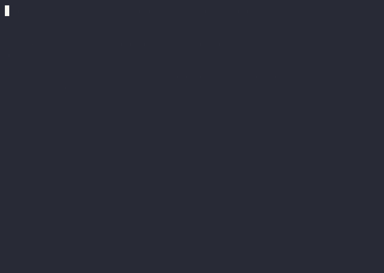
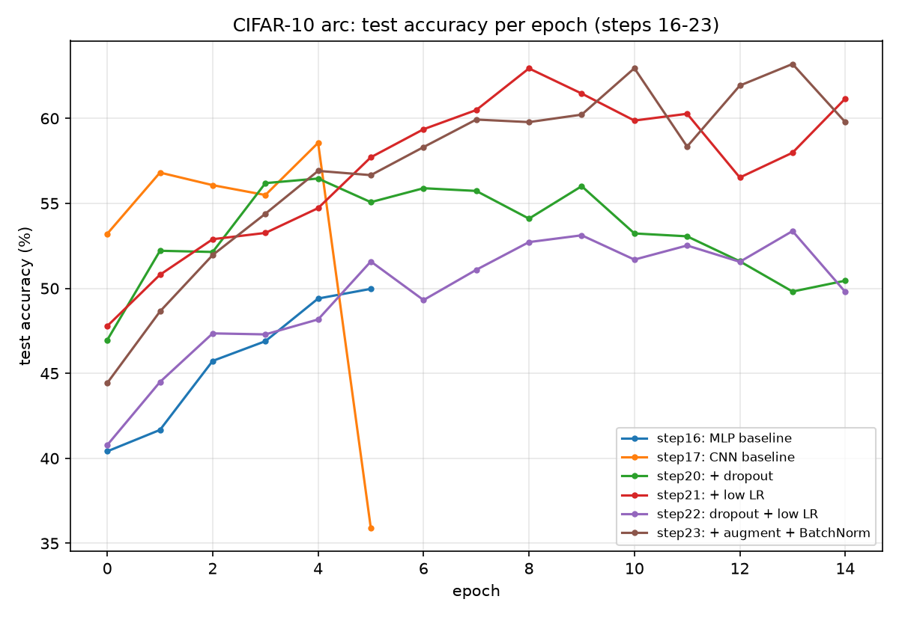

# claude

[](https://github.com/sanjay289/claude/actions/workflows/tests.yml)
[](https://github.com/sanjay289/claude/actions/workflows/tests.yml)
[](LICENSE)
[](https://www.python.org/downloads/)
[](https://ollama.com)
[](CONTRIBUTING.md)
[](CODE_OF_CONDUCT.md)

Experiments in agents, deep learning, and games — mostly Ollama-backed agents
built on a shared dependency-free graph engine.



`council.py` above, deliberating with a single local `llama3.2:3b` model
(fan-out to a member, then a separate chair pass to synthesize the verdict —
see [Components](#components) below). With multiple member models
configured it fans out to all of them in parallel and the chair can note
real disagreement between them.

## Featured: [`deep_learning/`](deep_learning/)

A from-scratch scalar autograd engine, built up step by step into CNNs
trained on MNIST and CIFAR-10 — 23 self-contained scripts, each changing one
thing from the last.

[](deep_learning/README.md)

See [`deep_learning/README.md`](deep_learning/README.md) for the full
step-by-step writeup, including what each change to the CIFAR-10 training
recipe actually did to accuracy and overfitting.

## Components

- **`graph_engine.py`** — a minimal node/edge graph runner for agent workflows.
  A `Graph` is nodes (`state -> state-update`) connected by edges: plain,
  conditional (branch on a router function), or fan-out (run several nodes in
  parallel on isolated copies of state, then join into one node with the
  per-branch results collected). No dependencies beyond the standard library.

- **`hermes_agent.py`** — a tool-using chat agent against a local/cloud
  `hermes3` model via [Ollama](https://ollama.com). Built as a graph: call
  the model, route to real tool execution or a bounded retry when the model
  writes a tool call as plain text instead of using the tool-calling
  interface, loop until it produces a final answer or hits the iteration
  cap. Tools include shell execution, file read/write, and a skill hub
  (`skills/*.md`) the model can discover and load before doing a task a
  skill covers. The model is set by `MODEL = "hermes3"` at the top of the
  file (the LangGraph port imports it too); point it at any tool-calling
  model you've pulled if `hermes3` isn't available.

- **`council.py`** — parallel multi-model deliberation. Several member
  models answer the same question independently and concurrently (a
  fan-out), then a separate chair model reads every answer and synthesizes
  a verdict, noting agreement and disagreement across the council.
  The defaults (`MEMBERS` and `CHAIR` at the top of the file) are mostly
  Ollama cloud models — only `llama3.2:3b` runs locally — so either sign in
  to Ollama for cloud access or edit those two lists to models you've pulled.

- **`hermes_agent_langgraph.py`** — `hermes_agent.py` ported onto
  [LangGraph](https://github.com/langchain-ai/langgraph): same tools and same
  graph shape, with only the graph itself rebuilt on LangGraph.

- **`langgraph_demo.py`** — a LangGraph agent with planning, sub-agent
  delegation, and memory, working through a cache-eviction comparison task.

- **`brain.py`** — capture and search for a "second brain": a plain folder
  of Obsidian-compatible markdown notes (`Inbox/` plus PARA folders) at
  `$BRAIN_VAULT`, defaulting to Android shared storage so the Obsidian app
  can open it. `brain add TEXT` appends a timestamped line to today's
  `Inbox/` note; `brain find TERM` searches with ripgrep and opens the
  match you pick in fzf in `$EDITOR`. `brain ask QUESTION` answers from
  your notes with local RAG: notes are split into paragraphs, embedded with
  `nomic-embed-text` (cached in the vault's `.brain/`, re-embedding only
  changed notes), and the closest chunks go to `llama3.2:3b`, which cites
  them as `[[Note Name]]`. Needs both models pulled.

- **`skills/`** — markdown skill files (`code-review.md`, `shell-safety.md`,
  `summarize.md`) that `hermes_agent.py` can load on demand via its
  `list_skills` / `use_skill` tools.

- **`tests/`** — unit tests for the graph engine, both agents, the council,
  the LangGraph demo, and `brain.py`, with model calls stubbed out so they run offline
  (no server, no model pulled).

- **[`unity-snake/`](unity-snake/)** — a minimal Snake game for Unity, in a
  single script that builds its own scene at runtime.

## Requirements

- Python 3.9+
- [Ollama](https://ollama.com) running locally, with the models referenced
  in `hermes_agent.py` (`hermes3`) and `council.py` (`MEMBERS`, `CHAIR`)
  pulled or available as cloud models
- Python packages: `pip install -r requirements.txt` (the LangGraph files
  need Python 3.10+; their tests are skipped on older versions)
- For `brain.py`: [ripgrep](https://github.com/BurntSushi/ripgrep) and
  [fzf](https://github.com/junegunn/fzf) (its search tests are skipped
  without ripgrep)
- For `deep_learning/`: [PyTorch](https://pytorch.org) and torchvision
  (`pip install torch torchvision`)

## Running

```bash
python3 hermes_agent.py   # interactive tool-using chat agent
python3 council.py        # interactive multi-model council
python3 hermes_agent_langgraph.py   # the same agent, on LangGraph
python3 langgraph_demo.py           # LangGraph planning/sub-agent demo
python3 brain.py add TEXT | find TERM | ask QUESTION   # second brain
```

## Testing

```bash
python3 -m unittest discover tests
```
